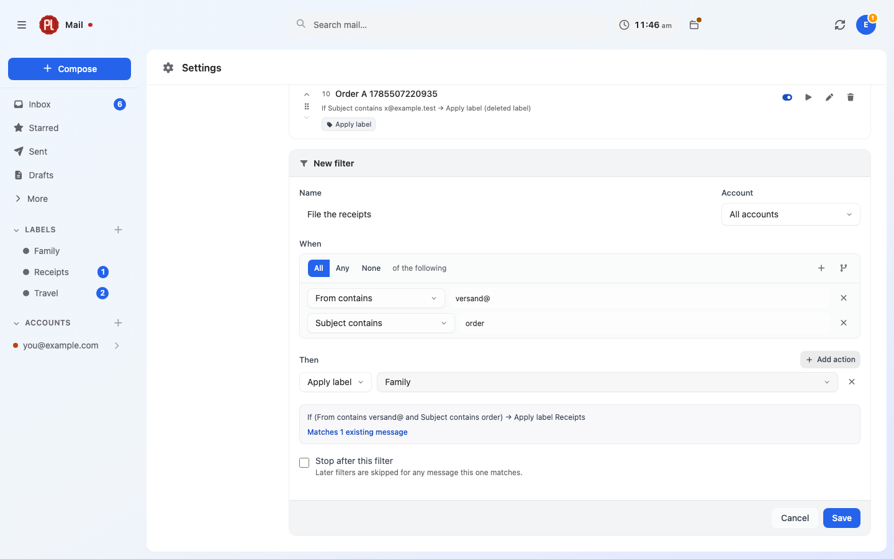

# Filters

A filter sorts mail for you as it arrives: label it, keep it out of the inbox, star it, bin it, or
push its attachments into a connected service. They live at **Settings → Filters**.



## What a filter is made of

Four things: a **name**, an optional **account** it is scoped to, a tree of **conditions**, and a
list of **actions**. The editor opens beside the list in its own frame, so building one does not
lose your place.

The account selector defaults to **All accounts**. Scoping a filter to one account is the usual
thing to want, and it matters more than it looks — see the trap about conditionless rules below.

## Conditions

Conditions are a tree. Every group states whether **All**, **Any** or **None** of the following
must hold, and groups nest as deep as the rule needs. **Add condition** adds a test to the current
group; **Add group** nests another group inside it.

| Condition | What it tests |
|---|---|
| **From contains** | Sender address or display name |
| **From is exactly** | The sender's whole address, and nothing else — not part of an address, and not the display name |
| **Sender's domain is** | Everything after the `@` of the sender's address, whole. Enter it without the `@`. A subdomain is a different domain |
| **To contains**, **Cc contains**, **Bcc contains** | The corresponding address list |
| **Subject contains** | The subject line |
| **Body contains** | The message body |
| **Anywhere in the message** | Full-text, stemmed — not a substring scan |
| **Attachment named** | Attachment filenames |
| **Mailing list is** | The canonicalised `List-Id` header |
| **Has label** / **Does not have label** | A label you own |
| **Larger than (bytes)** / **Smaller than (bytes)** | Message size |
| **Received after** / **Received before** | A date |
| **Has an attachment** | Yes or no |
| **Is** / **Is not** | One of: read, starred, a draft, replied to |

**Anywhere in the message** is the one worth singling out. It runs against the same generated
full-text column search uses, so it stems properly — which is why matching is done by Postgres and
not in PHP. There was briefly a second, in-memory matcher so a message could be tested without a
round trip; two implementations of "what this filter means" is a standing invitation to drift, and
the symptom of drift here is mail quietly filed in the wrong place.

**A filter with no conditions at all is allowed**, and means every message it is scoped to. That is
how "label everything arriving in this account" is written.

## Actions

| Action | Effect |
|---|---|
| **Apply label** | Adds one of your labels, creating its binding on the message's account |
| **Remove label** | Takes one off |
| **Mark as read** | |
| **Star it** | |
| **Skip inbox** | Removes the Inbox label — archiving, in other words |
| **Move to trash** | |
| **Mark as spam** | |
| **Save attachments to** | Uploads the message's attachments to a connected service |
| **File in category** | Files the mail under one of your own inbox tabs. Only offered once you have made one — see [Filing into your own tabs](#filing-into-your-own-tabs) |

At least one action is required; a filter with none would do nothing, and the editor says so rather
than saving it.

Skip inbox, move to trash and mark as spam are all "leave the inbox", differing only in where the
message lands afterwards. Each is pushed to the provider as one operation rather than as a
sequence of label changes, because a Gmail label swap and an IMAP folder move carry their own
semantics.

**Save attachments to** only offers services plMail can upload to, and only ones you have
connected — see [Files and integrations](integrations.md). The upload itself is queued rather than
performed inside the sync loop, so a service that is down slows nothing down, and messages without
attachments are skipped before anything is queued.

## The plain-English restatement

As you build a filter, the editor shows it back to you as a sentence: *If Subject contains invoice
→ Apply label Receipts*. Underneath it, a live count of how much of the mail you already have would
match.

Reading a filter back in words is how you catch an **All** that should have been an **Any** — the
tree looks equally correct either way. The sentence is built on the server, not in the browser, so
there is exactly one implementation of "what this rule says" and it is properly translated.

The sentence names labels and services rather than ids, and says **(deleted label)** or
**(disconnected service)** where one has gone missing underneath the rule.

The count is scoped to the same account the rule is, so the number and the sentence cannot describe
different things. It is capped at 500 — beyond that it reads **Matches 500+ existing messages** —
because the question being answered is "is this filter roughly right", and an exact count over a
large mailbox costs a full scan to tell you something you do not need.

`None of` is spelled out rather than written as a NOT, because NOT over several conditions means
"none of these" and reads to most people as "not all of these".

## Order, and stopping

Filters run in the order they are listed, and can be dragged to reorder. **Stop after this filter**
makes a match final: later filters skip any message this one claimed.

Order is not cosmetic here the way account order is — combined with stop-after it decides which
rule wins.

Each row also has **Enable filter** / **Disable filter**, so a rule can be parked without being
deleted, and **Delete filter**. Deleting a filter leaves the mail it already sorted exactly where
it is.

## When filters run

On mail as it arrives, once per batch of newly synced messages, after threading. Everything a
condition looks at has already been written by then.

Two paths deliberately never trigger a filter: the IMAP "Gmailify claim" branch, and Gmail's
enrichment of messages it already has. Both re-point rows that already exist rather than importing
new mail, and a rule firing there would re-file mail you had already sorted by hand.

A broken filter never fails a sync. A rule whose conditions no longer compile is skipped with a
warning, and an action that throws is logged and the message left alone.

## Applying a filter to mail that already arrived

**Apply to existing mail** on a saved filter walks your whole mailbox and applies it to everything
it matches. It is confirmed first, because it can move and relabel a great deal of mail at once.

The run is queued rather than performed in the request — it has to reach every matching message,
which over a real mailbox is far more than a web request should attempt. Progress is written to
the filter after every batch of 200, so the row reads **Applying… 1,400 so far** and keeps reading
that on a reload, on another device, or after you close the tab. It ends as **Applied to N
messages**, or **Run stopped partway — N messages were done** if something failed.

A filter already running refuses to start again: re-running mid-flight would double-count progress
and race the handler's writes.

## Filing into your own tabs

A filter can put mail into an inbox tab of your own. Make the tab first, under **Settings → General
→ Your own tabs**; then add a filter whose action is **File in category** and pick it. Any
condition works. For "everything from my parcel carriers" it is **Sender's domain is**, one row per
carrier, inside an **Any** group:

```
All of the following
  Any of the following
    Sender's domain is mondialrelay.fr
    Sender's domain is chronopost.fr
    Sender's domain is dhl.de
  None of the following
    Sender's domain is e-mail.mondialrelay.fr
    Subject contains satisfaction
→ File in category Shipping
```

**Keeping marketing out is the second group.** A carrier's newsletters often come from another
address than its delivery notices, but nothing in the headers tells the two apart — a real
delivery notice can carry an unsubscribe link just as a newsletter does — so you say it in the
filter. Mail the **None of** group excludes is simply not filed by this filter. It is sorted the way
it would have been anyway, so the newsletter stays in Promotions. The live count of matching mail
and the sentence under the editor read the whole thing back before you save it — a wrong **None of**
is easy to see there and hard to see afterwards.

What the action will and will not file:

- **Only mail whose sender passes authentication.** The receiving mail server records whether the
  message really came from the domain in its From line, and plMail reads that verdict (the same one
  that decides whether a calendar invitation may be applied without asking). A forged "your parcel
  is waiting" from a carrier's domain is therefore not filed by this filter — it stays where the
  ordinary rules put it, instead of sitting in your Shipping tab beside the real ones. Mail that
  fails the check is not filed, and neither is mail plMail cannot check; see "Things that bite" for
  what this does and does not guarantee.
- **On Gmail accounts too.** Google's categories outrank plMail's own sorting unless you say
  otherwise, but a filter is an instruction you wrote, and it outranks both.
- **Nothing but a tab.** The action does not touch labels, does not archive, does not move anything
  to Spam and does not mark anything read. The Android app shows your tabs; other mail apps that
  connect over JMAP keep seeing the five built-in categories.

A conversation is in **one** tab. It is in yours when its newest message was filed there, so a
newer message no filter claims takes it back out, the way a newer Promotions message takes a
conversation out of Updates. A conversation you drag onto a tab stays there whatever a filter says.

When two filters would file the same message, the one that runs **last** decides; **Stop after this
filter** on the earlier one is how you keep its choice.

Deleting a tab puts its mail back in the tab it would otherwise be in. No mail is deleted, and a
filter that filed into it keeps its place and reads **(deleted category)** until you point it
somewhere else.

## Where to read further

- [Mail](mail.md) — labels, search, and the operations these actions perform.
- [Tabs of your own](mail.md#tabs-of-your-own) — making them, dragging into them, and what the
  message panel says about them.
- [Files and integrations](integrations.md) — connecting the services **Save attachments to**
  offers.
- [Mail ingest](../internals/mail-ingest.md) — where in the pipeline filters sit.
- [JMAP](../internals/jmap.md) — the filter vocabulary as a client sees it.

## Things that bite

**A filter with no conditions and no account means every message in every account.** It is a legal
filter and a useful one when scoped, but scoped to All accounts it is a rule that catches
everything you own — and **Apply to existing mail** on it then reaches the entire mailbox. The
restatement says so in as many words; read it before saving.

**The match count is capped at 500 and the run is not.** "Matches 500+" is not an estimate of how
much **Apply to existing mail** will touch. That number can be any size.

**Filters only see mail arriving from now on.** Saving one does nothing to mail already synced
until you press **Apply to existing mail**.

**A malformed action is dropped silently; a malformed condition is refused loudly.** That asymmetry
is deliberate — a dropped condition silently *widens* a rule, which is the dangerous direction,
whereas a dropped action can only ever be a client bug and dropping it is the conservative outcome.

**Deleting a label or disconnecting a service does not delete the rules referring to it.** They
keep running with that action doing nothing, and the restatement marks the gap as **(deleted
label)** or **(disconnected service)**.

**Stop-after only applies within one run.** It decides which later filters skip a message in the
same pass; it is not a permanent mark on the message.

**Ticking "Save attachments to" for a service that can only be read from is impossible by
construction** — the list only offers upload-capable connections. If the one you want is missing,
that is why.

**"File in category" files nothing on an account whose receiving server plMail cannot identify.**
It trusts only the authentication verdict a server it can tell is yours wrote into the message — for
an IMAP account, one whose name is on the same domain as the account's IMAP host. On a mailbox
where that cannot be told (a host that stamps nothing, or stamps under another name), a filter
that files into a tab matches, runs and files nothing. That is the price of a tab that cannot be
filled with forgeries, and it is chosen, not a bug.

**The check is about the message, and it only helps if the filter names the sender.** A filter whose
conditions do not pin the sender — "Subject contains parcel", say — files any sender whose own
domain passes authentication, a lookalike domain included: authentication proves a message came from
the domain it claims, not that the domain is the one you meant. Pin the sender with **Sender's
domain is**. And a tab holds conversations, not messages: a forged message that replies into a
genuine conversation (the same sender address, a "Re:" subject) can join it, and a conversation you
dragged into a tab stays there whatever joins it afterwards.

**A filing is remembered, and editing or deleting the filter does not undo it.** Like every other
action, it acts on mail and leaves the result: mail a filter filed stays filed. To re-file, change
the filter and press **Apply to existing mail**; to empty a tab, drag its conversations out or
delete the tab.

**The last filter to file a message wins** — the opposite of what the order of a list of rules
usually suggests. Put a broad filter above the specific ones, or give a specific one **Stop after
this filter**.
